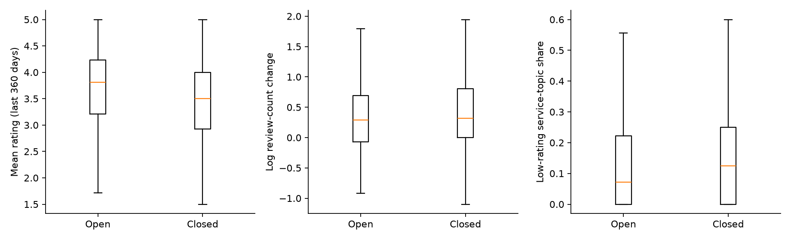
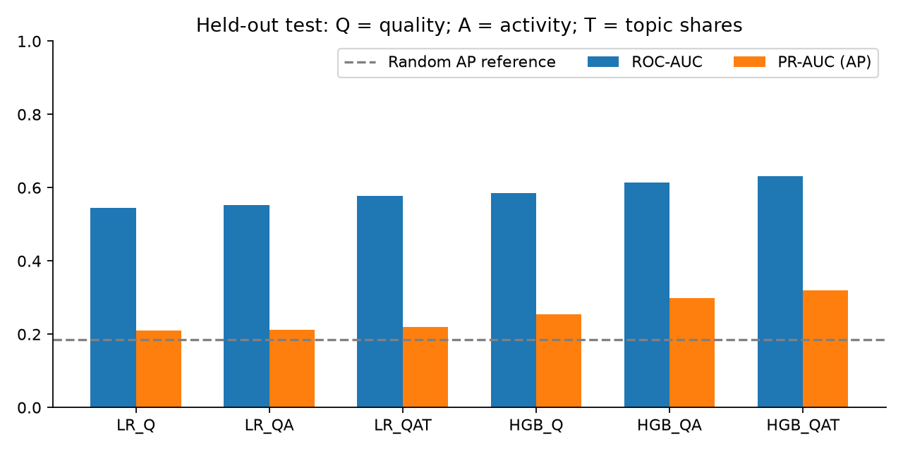
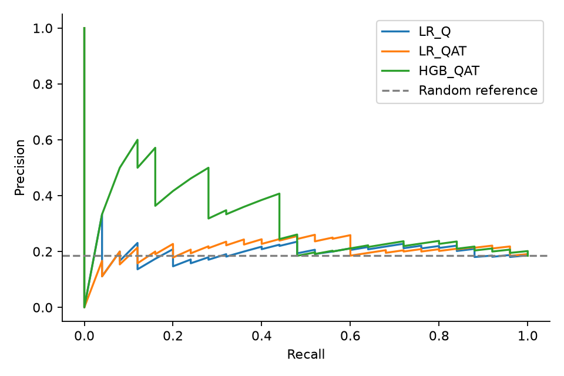
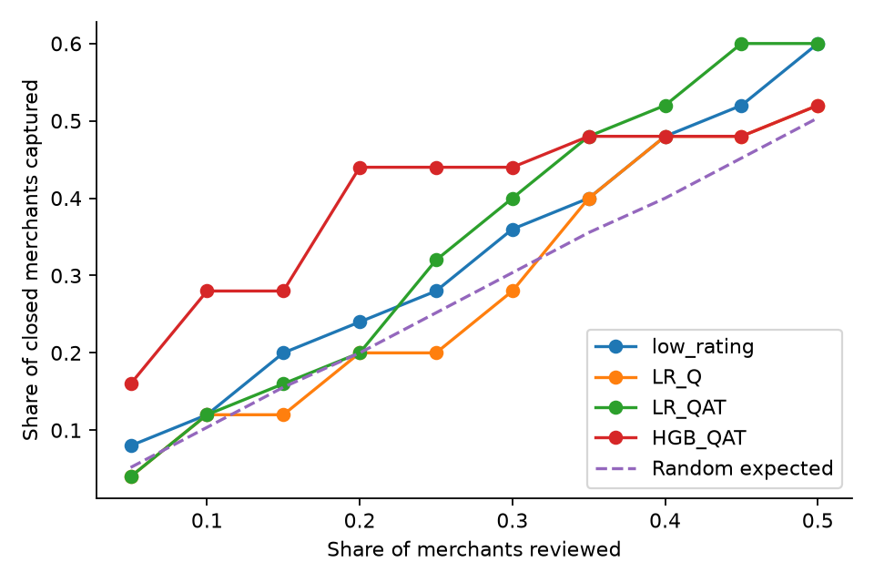
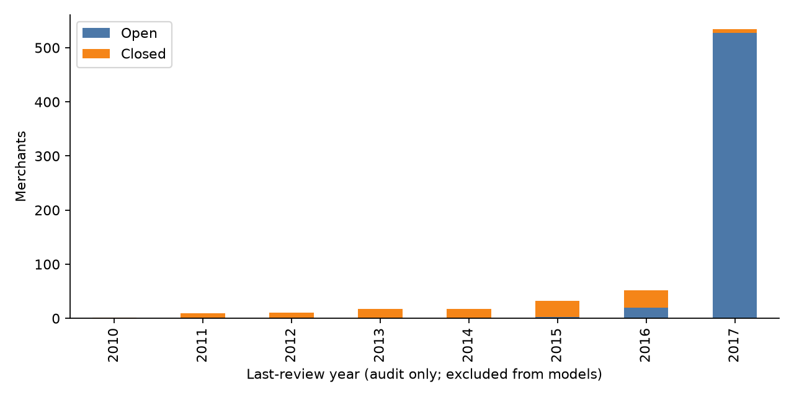

# 公开口碑信息对餐饮商户经营状态的识别价值：阶段分析报告

**用途：2026 FinTechathon 赛题三研究素材与分析底稿；尚非最终排版参赛PDF。**

**完成状态：公开子集已下载并校验，字段和样本数量已核对，清洗、指标计算、描述分析、模型比较及复核预算验证均已实际运行。官网当前使用条款及镜像再分发许可尚未确认，这一项仍未完成；本地研究底稿不能据此直接宣称具备参赛发布许可。**

## 摘要

本研究使用某生活服务平台的 Cleveland 区域公开历史商户评论子集，从口碑质量、评论活跃度和低分评论主题三个维度构建12项指标，检验公开信息对商户营业状态的识别价值。最终纳入674家餐饮商户，其中123家记录为停止营业。训练、验证、测试按商户独立划分为404、135、135家。依据验证集选择的增强逻辑回归模型测试ROC-AUC为0.577，AP为0.220；相较于质量指标基线的AP增量为0.009，配对Bootstrap区间包含0。预设增强树模型测试ROC-AUC为0.631，AP为0.319，在约10%的复核预算下识别7家停止营业商户，相对随机名单的点估计提升2.70倍，但区间仍包含无提升的可能。结果支持继续探索低成本调查排序，不支持已证明信用风险预测能力、稳定业务增益或直接自动授信。

## 一、背景与研究问题

小微餐饮经营主体通常缺少标准化财务信息。公开评价可能反映消费体验和经营关注度，因此可作为金融机构调查的补充信息。本研究检验：相较于仅使用评分质量信息，增加评论活跃度与低分评论主题，能否提升营业状态识别及有限人工复核名单的命中率？

没有真实经营流水、贷款逾期记录、关闭日期或经核验的企业规模。本研究的因变量是公开子集商户表中的 `is_open`，停止营业记为1，营业记为0。停业可能由搬迁、主动退出等原因导致，不等于财务困境或违约。餐饮商户只是小微主体的研究代理，不能断言每家都是小微企业。

## 二、数据来源、条款与清洗

原始来源为 Yelp Open Dataset。实际下载来源为 GitHub 上 `ahegel/yelp-dataset` 的 Cleveland 子集，固定到提交 `e5b82be3c909f9bb45dfd03e164ae0b7897832bd`。公开来源附有区域筛选代码，规则是城市名称包含“leveland”。本研究自行计算指标和模型，没有复用该项目的分析结果或其他项目的预计算特征。

两个输入文件为JSONL，共3,164家商户和91,057条评论；餐饮评论共64,693条。评论日期范围为2005-04-15至2017-07-26。营业状态采集日期未在子集说明中提供，不能假定所有标签都在同一个准确时点测量。文件SHA256与下载网址已保存在 `sources/data_manifest.json`，以支持重复分析。

**条款核实状态。** 当前环境代理对Yelp官网请求返回403，尚未取得当前协议。已归档一份最后更新于2015年3月23日的历史学术数据协议，来自另一个学术项目仓库；其学术使用许可条款和原始数据再分发、商业用途限制仅供历史背景核对，不能证明当前授权或当前镜像再分发权限。示例代码的Apache软件许可也不适用于数据本身。正式提交前仍需核实官网当前条款、该教育比赛用途与数据获取渠道。没有将原始评论、评论者信息或具名商户记录纳入报告。

表1 样本筛选与数据质量核对

| 步骤 | 数量/结果 |
|---|---:|
| 原始区域商户 | 3,164 |
| 餐饮且营业状态有效的商户 | 1,361 |
| 其中停止营业商户 | 318 |
| 剔除总评论数不足10条 | 461 |
| 随后剔除历史跨度不足365天 | 49 |
| 随后剔除最近180天评论不足3条 | 177 |
| 最终样本 | 674 |
| 最终停止营业/营业 | 123 / 551 |
| 重复评论ID、无效日期/评分、未匹配商户 | 0 / 0 / 0 |
| 原商户表评论总数与实际评论数不一致 | 64家（全商户样本） |

最终635家来自 Cleveland，39家来自 Cleveland Heights；停止营业占比为18.25%。上述剔除顺序固定，未依据模型效果调整。筛选会排除新店、低评价量商户和长期无评论商户，因此结果不能代表所有餐饮商户。商户表评论总数不一致的原因未确认；模型所有计数都从实际评论重新计算，没有使用该总数字段。

## 三、指标体系与描述性分析

每家商户以其最后一条评论日期为观察窗口锚点。近360天采用距锚点0—359天；近期和前期分别为0—179天及180—359天。各商户窗口不是统一日历时间，因此是历史横截面比较，不是前瞻预测设计。

表2 指标体系

| 维度 | 指标 | 解释与限制 |
|---|---|---|
| 口碑质量Q | 近360天均分、低分占比、标准差；近期减前期均分 | 反映平台评价质量，不等于偿债能力 |
| 评论活跃度A | 近期/前期评论数；对数数量变化；6个30天窗口数量变异系数 | 反映平台关注度，不是真实交易流水 |
| 评论主题T | 近期评分≤2且提及服务、卫生、价格、食物问题的评论占比 | 透明词典匹配，不是经人工验证的精确投诉分类 |

对数数量变化为 `log(1+近期数量)-log(1+前期数量)`。各主题分母均为近期全部评论数，不是低分评论数。词典、正则表达式及公式见 `feature_dictionary.csv`。40家商户前期窗口无评论，均分变化记缺失；中位数填补及缺失指示变量只在训练数据拟合，避免用测试集信息预处理。

表3 主要指标组间均值（全样本探索性描述）

| 指标 | 营业商户 | 停止营业商户 |
|---|---:|---:|
| 近360天评论均分 | 3.66 | 3.43 |
| 近期减前期评分 | 0.002 | -0.265 |
| 近180天评论数 | 11.21 | 7.63 |
| 近期低分且提及价格的评论占比 | 4.04% | 7.57% |
| 近期低分且提及卫生的评论占比 | 1.91% | 1.53% |

停止营业商户均分较低、评分下降较多，但并非每个负面主题都呈现预期方向。卫生主题占比在停止营业组反而略低，不能据此宣称卫生风险是停业原因。评论数均值不同，近期评论数中位数却都为7条，说明分布偏态，不能只比较均值。Mann–Whitney检验及12项比较的Holm校正存于 `descriptive_stats.csv`；描述性差异不构成因果证据。

图1 营业与停止营业商户的评分、评论变化及服务主题分布（箱线图不显示离群点）

## 四、模型设计与独立测试

训练集404家（停止营业73家），验证集135家（25家），测试集135家（25家），按标签分层并以商户为单位一次固定划分，随机种子20261011。同一商户不会跨集合。采用逻辑回归LR和直方图梯度提升树HGB，分别比较Q、Q+A、Q+A+T三组输入，共六个预设模型。

逻辑回归比较C=0.1、1、10；树模型比较最大叶节点7、15与L2系数1、5，迭代150次、学习率0.05、叶节点最少20个样本。每个模型只用验证集AP选参数，再以训练及验证集合并数据重拟合。增强模型与质量基线分别依据验证集选出 **LR_QAT** 与 **LR_Q**。没有因为另一模型测试效果更好而回头更换主分析模型。实际测试指标均保留。

表4 六个预设模型的验证与测试结果

| 模型 | 指标组 | 验证集AP | 测试ROC-AUC | 测试AP | 前10%复核命中数/14 |
|---|---|---:|---:|---:|---:|
| LR_Q | Q | 0.301 | 0.545 | 0.211 | 3 |
| LR_QA | QA | 0.320 | 0.552 | 0.212 | 3 |
| LR_QAT | QAT | 0.344 | 0.577 | 0.220 | 3 |
| HGB_Q | Q | 0.259 | 0.585 | 0.253 | 5 |
| HGB_QA | QA | 0.323 | 0.614 | 0.299 | 5 |
| HGB_QAT | QAT | 0.304 | 0.631 | 0.319 | 7 |

AP是非插值平均精确率，作为PR表现指标，本文没有混用梯形积分的PR面积。测试停止营业比例为18.52%，为随机排序AP的总体参考；准确率不是主指标。预测输出仅用于该历史样本的状态排序，不解释为校准的未来停业概率或违约概率。

主分析增强逻辑回归相对质量基线AP仅增加0.0091，1500次配对商户Bootstrap的95%区间为[-0.055, 0.064]，包含0。增强树模型相对其质量基线AP增加0.0658，配对区间为[-0.038, 0.185]。这些区间只描述固定模型及本次测试划分下的抽样不确定性，不涵盖训练重拟合和模型选择的不确定性，也未对六模型探索性比较作家族显著性校正。

图2 六个预设模型的独立测试ROC-AUC与AP

图3 主分析基线、增强模型与预设增强树模型的测试精确率—召回率曲线

## 五、应用验证：人工复核预算

假设金融机构只能核实约10%的商户。测试集135家，向上取整选14家，实际预算比例为10.37%。对比随机名单的理论期望、低评分名单、主分析模型名单和预设增强树模型名单。后者是透明展示的探索性对比，不能因测试表现较高就认定其已完成部署模型选择。

表5 约10%复核预算下的模拟结果

| 策略 | 复核数量 | 命中停止营业商户 | 名单停止营业占比 | 捕获率 | 相对随机提升倍数 |
|---|---:|---:|---:|---:|---:|
| random_expected | 14 | 2.59（期望） | 18.5% | 10.4% | 1.00 |
| low_rating | 14 | 3 | 21.4% | 12.0% | 1.16 |
| LR_Q | 14 | 3 | 21.4% | 12.0% | 1.16 |
| LR_QAT | 14 | 3 | 21.4% | 12.0% | 1.16 |
| HGB_QAT | 14 | 7 | 50.0% | 28.0% | 2.70 |

随机名单平均期望命中2.59家；这不是声称某次随机抽查实际命中了小数家。低评分及主分析增强逻辑回归均命中3家，没有体现更高的复核效率。预设增强树模型命中7家、名单停止营业占比50%，捕获测试集25家停止营业商户中的28%。即使采用该树模型，仍漏掉72%的停止营业商户，也有一半名单是营业商户。

增强树模型Lift点估计为2.70，Bootstrap95%区间为[0.96, 3.75]，包含1。不能写成已证实“金融机构风险发现效率提升170%”，更不能推导真实资金损失、回收率或拒贷收益。它仅提供下一阶段扩大样本验证的候选排序方案。20%和30%预算结果保存在 `review_budget.csv`。

图4 不同复核预算下的停止营业商户捕获率（随机线为预算对应的理论期望）

## 六、偏差检查与使用边界

1. **日期结构差异明显。** 551家营业商户中528家最后评论在2017年；123家停止营业商户中只有6家最后评论在2017年。将“距全数据末日的无评论天数”直接做特征，会把状态痕迹误当成提前预警能力。本研究没有将最后评论日期、年份、当前营业状态文字或关闭词汇放入模型，但不同窗口年代造成的混杂仍无法完全消除。
2. **敏感性检查没有证明稳定增益。** 在测试集最近评论年份为2015及之后的125家商户中，主分析模型ROC-AUC为0.525，AP为0.141，停止营业比例为12%；表现接近随机。至少20条总评论的114家子样本ROC-AUC为0.558。详情保存在 `sensitivity_checks.csv`，均使用原模型预测，未为追求更高分重新选样本或调参。
3. **不能确认先后关系。** 无关闭日期、营业状态采集日期或贷款表现，评论可能已经反映关闭前后情况。随机商户划分验证的是同类历史记录的状态识别，不能声称跨时间或跨区域泛化，更不能称为真实提前预警。
4. **平台与样本选择偏差。** 平台评论不代表全部消费者、真实客流或营业额；评价较多且历史较长的商户更容易纳入。评论主题采用低分加词典，尚未进行独立人工标注验证；商户主体规模与连锁关系也未核验。
5. **历史与地域限制。** 评论截至2017年，海外历史餐饮样本无法证明2026年深圳小微企业适用性。Bootstrap区间较宽，需新样本与独立地区复验。

图5 最后评论年份与营业状态的分布差异（此年份仅用于审计，不作为模型输入）

## 七、可用于参赛报告的结论与产品建议

**结论建议：** 公开口碑与评论活跃度提供了可计算、可解释的商户状态画像。在该小规模历史样本中，树模型的部分指标呈现潜在识别价值，但按验证集确定的主分析方案并未显示稳定增量，日期混杂与样本不确定性使结果不足以支持直接授信。更合理的应用定位是补充人工调查线索，而非以公开评分替代真实经营流水和信用标签。

产品可输出“调查优先级、触发指标、信息可信度”，低评价量和新店显示信息不足。下一阶段首先获取统一观察日期、经核实的未来关闭记录或真实流水，并核实企业规模；其次使用严格时间外和地区外测试验证增量与复核收益；再结合真实人工调查成本估计经济价值。评分不得在未经验证时直接触发拒贷。

## 参考来源与复现材料

1. Yelp Open Dataset官方入口：https://www.yelp.com/dataset （本环境当前访问受限）。
2. 实际公开子集及筛选说明：https://github.com/ahegel/yelp-dataset/tree/e5b82be3c909f9bb45dfd03e164ae0b7897832bd 。
3. 历史协议归档：https://github.com/vc1492a/Yelp-Challenge-Dataset/blob/0402872665e57c253ba7dcbb71b10842bc1ef08a/Raw%20Data/yelp_dataset_challenge_academic_dataset/Dataset_Challenge_Academic_Dataset_Agreement.pdf （更新日期2015-03-23，不能代替当前协议）。
4. 本地代码：`scripts/download_data.py`、`scripts/prepare.py`、`scripts/analyze.py`、`scripts/write_report.py`。详细指标、数据审计、划分、全部测试预测、模型对比和复核预算表已保存。本文结果全部来自本次真实执行，没有模拟或补造样本、风险标签或业务流水。
