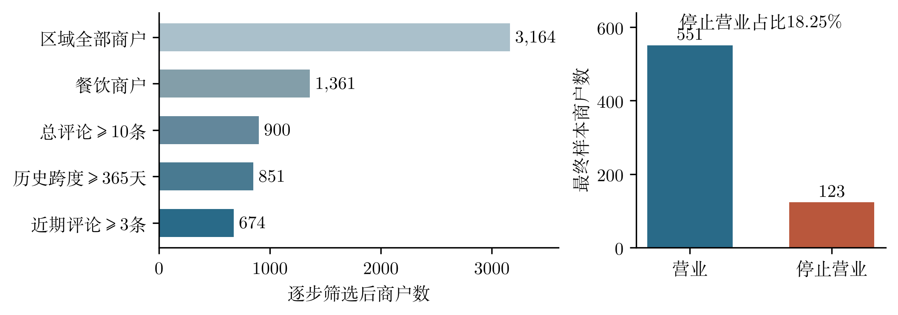
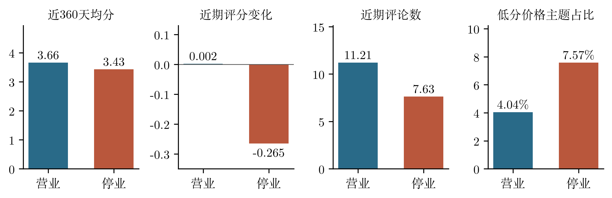
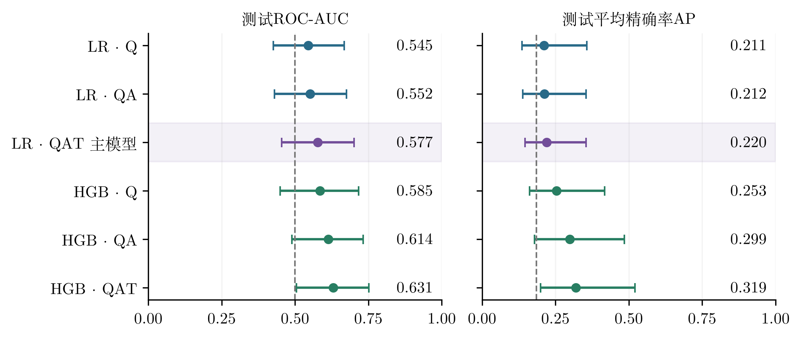
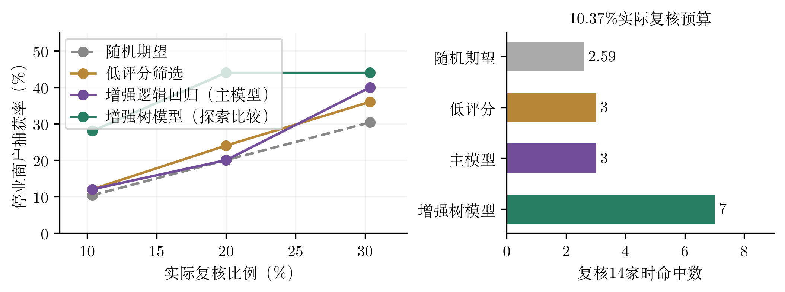
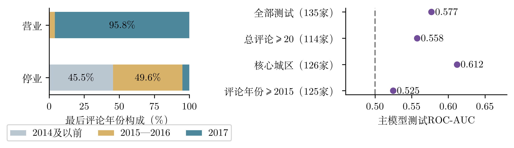

# 基于公开口碑信息的餐饮商户经营风险画像及验证
——营业状态识别的可行性研究

小组名称：待填写

<!-- 封面后正文共8页；参考文献另页；PDF页数已经单独核验。 -->

<!-- 正文第1页 -->
## 摘要

针对小微餐饮主体财务信息稀缺的问题，本文研究公开口碑信息能否补充经营风险画像。基于某生活服务平台的海外历史区域子集，筛选674家餐饮商户，其中123家记录为停止营业；围绕口碑质量、评论活跃度和低分评论主题构建12项指标，比较逻辑回归与梯度提升树的六种输入组合，并进行独立测试和人工复核预算模拟。按验证集确定的增强逻辑回归，测试ROC-AUC为0.577、平均精确率AP为0.220；相对评分质量基线的AP增量为0.009，95%配对Bootstrap区间包含0。预设增强树模型AP为0.319，在复核14家测试商户时命中7家停止营业商户，相对随机名单的点估计提升2.70倍，但区间仍包含无提升的可能。公开信息可形成低成本调查线索，尚未证明稳定的风险识别增益。由于缺少关闭日期、真实流水和信用表现，结果仅支持历史营业状态识别，不能解释为提前停业预测或信用违约预测。

关键词：公开数据；餐饮商户；经营风险画像；营业状态；人工复核

## 一、业务背景与研究问题

小微经营主体现金流缓冲有限，传统财务风控又依赖标准化报表和信用记录。生活服务平台的公开评价覆盖消费体验、商户活跃度及经营环境，为信息稀疏主体提供了另一条观察路径。但公开评分与经营风险的关系可能受到平台选择、商户规模和时间结构影响，必须用独立样本验证，不能把低评分直接等同于高信用风险。

本文提出三个问题：第一，能否将公开评论转化为可解释的经营画像指标？第二，相较于只看评分质量，评论活跃度和低分主题是否提供增量识别价值？第三，在人工核查预算有限时，模型排序是否比随机抽查或低评分筛选更有效？研究以餐饮业为代表，以公开营业状态作为可得的替代验证标签。

赛题强调在经营流水基础上引入公开信息。本研究未获得真实流水，因此检验的是公开信息的独立识别价值，尚未验证其对流水模型的增益。样本也缺少企业规模和贷款表现，餐饮商户仅作为小微主体的研究代理。停业可能来自搬迁或主动退出等原因，不等于财务困境。

<!-- 正文第2页 -->
## 二、数据介绍与样本清洗

原始来源为某生活服务平台的学术开放数据[1]，实际使用其社区发布的区域子集[2]。子集以城市名称包含“leveland”的规则筛选，覆盖Cleveland及邻近区域。本研究固定数据来源提交并校验两个输入文件，独立计算指标和模型，没有复用来源项目的模型结果。商户表含类别、城市和营业状态；评论表含商户ID、日期、评分和文本。

原始数据含3,164家商户、91,057条评论。评论日期为2005年4月15日至2017年7月26日，营业状态的采集日期未说明。1,361家餐饮商户中，318家标记停止营业；其评论共64,693条。按照评价数量、历史跨度及近期可观测性逐步筛选，最终纳入674家，其中营业551家、停止营业123家，停止营业占比18.25%。

图1 样本逐步筛选及最终营业状态分布

表1 数据质量与样本纳入规则

| 核对项目 | 结果或处理规则 |
| --- | --- |
| 商户与评论关联 | 商户ID无重复；评论ID无重复；评论均匹配商户 |
| 日期与评分 | 无无效日期；评分均处于1—5分 |
| 纳入门槛 | 总评论≥10条；历史跨度≥365天；近180天评论≥3条 |
| 计数一致性 | 64家商户表总评论数与实际评论数不一致，原因未确认 |
| 计数处理 | 所有计数从实际评论重新计算，不使用商户表总数 |

最终样本包含核心城区商户635家、邻近城区39家。筛选排除了新店、评价较少及长期无评论的商户，改善指标可观测性，也形成样本选择偏差。全部报告图表均为匿名聚合结果，不展示商户名称、评论者信息或原始评论。

<!-- 正文第3页 -->
## 三、指标体系与描述性分析

以各商户最后一条评论日期作为历史窗口锚点：近360天为距锚点0—359天，近期与前期分别为0—179天和180—359天。窗口在不同商户之间不对应统一日历时间，因而本设计属于历史横截面比较。基于经营机制构建三类、共12项指标，见表2。

表2 三维经营风险画像指标体系

| 维度 | 指标（每维4项） | 业务含义 |
| --- | --- | --- |
| 口碑质量Q | 近360天均分、低分占比、评分标准差；近期较前期均分变化 | 衡量消费者评价水平、分歧及变化 |
| 评论活跃度A | 近期/前期评论数；数量对数变化；六个30天窗口数量变异系数 | 衡量平台消费关注度及波动 |
| 低分主题T | 近期低分且提及服务、卫生、价格、食物问题的评论占比 | 识别可供调查核实的经营体验线索 |

数量变化定义为log(1+近期数量)-log(1+前期数量)。低分指评分不超过2分；各主题以固定词典匹配，分母为近期全部评论数。40家商户前期窗口无评论，其均分变化记为缺失，在拟合数据上作中位数填补并增加缺失指示。评论数不是客流或营业额，词典主题也未经独立人工标注验证。

图2 营业与停止营业商户的主要指标均值（全样本探索性描述）

停止营业商户近360天均分为3.43，营业商户为3.66；近期评分变化均值分别为-0.265与0.002。近期评论数均值分别为7.63与11.21，但两组中位数均为7，说明分布偏态。价格主题占比在停业组较高，卫生主题则未呈现预期方向。组间差异以Mann–Whitney检验并作12项Holm校正，仅作探索性描述，不用于因果推断。

<!-- 正文第4页 -->
## 四、模型分析与验证设计

以商户表记录的停止营业为正类，营业为负类。按商户独立、标签分层，一次固定划分训练、验证、测试集合，随机种子为20261011。同一商户不会跨集合，测试集保留到参数与主分析方案确定后使用；划分比例为60%/20%/20%，见表3。

表3 样本划分与标签构成

| 集合 | 商户数 | 停止营业数 | 占比 |
| --- | --- | --- | --- |
| 训练集 | 404 | 73 | 18.07% |
| 验证集 | 135 | 25 | 18.52% |
| 测试集 | 135 | 25 | 18.52% |

采用逻辑回归（LR）作解释性基线，以及直方图梯度提升树（HGB）检验非线性关系。每种算法均比较Q、Q+A、Q+A+T三组输入，共六个预设模型，以分离评分、活跃度与评论主题的增量。没有将当前营业状态文字、关闭词汇、最后评论年份或距数据末日的无评论天数放入模型。

逻辑回归在C=0.1、1、10中选择正则强度；树模型比较最大叶节点7、15及L2系数1、5，固定150次迭代、学习率0.05、每叶最少20个样本。每种算法与指标组仅用验证集平均精确率AP选参数，再合并训练和验证集重新拟合。逻辑回归标准化、所有缺失填补及缺失指示均只在拟合数据估计。

质量基线在LR·Q与HGB·Q中按验证集AP选择，增强方案在LR·QAT与HGB·QAT中同样选择。由此主分析基线为LR·Q，主分析增强模型为LR·QAT。增强树模型虽然测试表现较好，但没有据此回头改选为主模型。全部预设模型均保留，并明确区分主分析与探索比较。

验证使用ROC-AUC、平均精确率AP和有限预算下的复核命中率、捕获率及提升倍数。AP采用非插值平均精确率，不混用梯形积分PR面积；测试停止营业比例18.52%作为随机排序AP的总体参考。对测试商户作1,500次配对Bootstrap，报告百分位95%区间；该区间不涵盖训练重拟合、模型选择或外部地区的不确定性。

<!-- 正文第5页 -->
## 五、模型结果与增量价值

六个模型的独立测试点估计和Bootstrap区间见图3。质量基线LR·Q测试ROC-AUC为0.545、AP为0.211；主分析增强LR·QAT分别为0.577和0.220。加入活跃度与主题后的改善较小，不能据此声称公开信息已显著提升风险识别。

图3 六个预设模型的测试表现及95%Bootstrap区间；虚线为随机参考

表4 预设模型的验证与测试结果

| 模型 | 验证AP | 测试ROC-AUC | 测试AP |
| --- | --- | --- | --- |
| LR·Q | 0.301 | 0.545 | 0.211 |
| LR·QA | 0.320 | 0.552 | 0.212 |
| LR·QAT（主模型） | 0.344 | 0.577 | 0.220 |
| HGB·Q | 0.259 | 0.585 | 0.253 |
| HGB·QA | 0.323 | 0.614 | 0.299 |
| HGB·QAT | 0.304 | 0.631 | 0.319 |

主模型相对质量基线的AP增量为0.0091，配对95%区间为[-0.055，0.064]。增强树模型相对其质量基线的AP增量为0.0658，区间为[-0.038，0.185]。两者均包含0，无法排除无增益的情况。树模型中QA相对Q、QAT相对QA的AP点估计均有所增加，可作为扩大样本后进一步验证的线索。

本次测试仅含25家停止营业商户，区间较宽；多模型比较未作家族显著性校正，结果应按探索性证据理解。模型输出仅表示历史样本的状态排序，不视为校准的未来停业概率或贷款违约概率，也不据测试最高分直接决定部署方案。

<!-- 正文第6页 -->
## 六、应用验证：有限预算下的人工复核

设定金融机构每期只能核实约10%的商户。对135家测试商户向上取整选14家，实际预算比例为10.37%，对比随机抽查、最低评分筛选、主分析方案及预设增强树模型。停止营业标签仅用于事后核对名单，未用于选择名单或调整模型参数。

图4 不同复核预算下的停业商户捕获率及约10%预算的命中数

表5 复核14家测试商户的模拟效果

| 策略 | 命中数 | 名单命中率 | 停业捕获率 | 提升倍数 |
| --- | --- | --- | --- | --- |
| 随机抽查（期望） | 2.59 | 18.52% | 10.37% | 1.00 |
| 低评分筛选 | 3 | 21.43% | 12.00% | 1.16 |
| 质量基线LR·Q | 3 | 21.43% | 12.00% | 1.16 |
| 主模型LR·QAT | 3 | 21.43% | 12.00% | 1.16 |
| 增强树模型HGB·QAT | 7 | 50.00% | 28.00% | 2.70 |

随机名单2.59家为理论期望，不是某次抽查实际命中了小数家。主模型与低评分名单均命中3家，未表现出额外复核效率。增强树模型命中7家，提升倍数点估计为2.70，但95%区间为[0.96，3.75]，包含1；模型相对随机的优势仍需独立复验。此树模型属于预设探索比较，不能因测试表现高而追认为已定型的部署模型。

增强树模型在约10%预算下仍漏掉72%的停止营业商户，且名单中一半商户仍在营业。因此这类输出更适合安排低成本人工核实，而非直接拒贷。该模拟也没有衡量真实违约、回收损失、核查成本或干预效果，不能将点估计转化为确定的商业收益。

<!-- 正文第7页 -->
## 七、偏差检查、敏感性与研究限制

营业与停止营业组的最后评论年份存在明显差异：551家营业商户中528家最后评论在2017年，123家停止营业商户中只有6家在2017年。图5展示这一结构及固定主模型的子样本敏感性结果。日期没有作为模型输入，但窗口年代差异仍可能影响评论量与消费行为。

图5 日期结构差异及固定主模型的子样本敏感性核对

将测试样本限定为最后评论年份2015年及之后时，125家商户中15家标记停业，主模型ROC-AUC为0.525、AP为0.141，接近随机表现。至少20条总评论的114家子样本ROC-AUC为0.558。上述核对只筛选原测试预测，没有为提高分数重新调参；未证明主分析增益稳定。

标签边界：没有关闭日期、统一状态采集日期、贷款逾期或真实流水，无法验证评论在风险事件之前可用。随机商户划分只检验同类历史记录的状态识别，不代表跨时间预警能力。停业也不能直接作为违约标签。

样本边界：平台消费者并非全部客群，评价数不等于营业额。新店、低评价量和长期无评论主体被排除；企业规模、连锁关系和评论真实性尚未核验。词典主题只反映低分评论中的话题提及，不是精确投诉归因。

外推与使用边界：评论截至2017年，海外区域样本不能证明2026年深圳小微企业适用性。当前官方数据协议及该镜像的再分发授权尚待核实，2015年历史协议[3]不能代替当前许可。本报告不披露原始评论及具名商户，正式提交前应确认教育比赛使用范围。

<!-- 正文第8页 -->
## 八、产品思路与商业应用

建议将产品定位为“小微商户经营线索助手”：把公开信息转化为调查优先级、触发原因和数据可信度，服务贷前信息补充与贷后人工核查。现阶段不输出“违约概率”，也不以平台评分直接决定拒贷。公开数据模块应与真实流水模块并列，保留各自的信息来源和不确定性。

表6 产品模块、输出与业务动作

| 模块 | 输出 | 建议动作 |
| --- | --- | --- |
| 数据可用性 | 评论数量、覆盖跨度、更新情况 | 不足时提示“信息不足”，补充资料 |
| 经营画像 | 评分变化、活跃度、低分主题 | 核实具体经营问题，查看实际流水 |
| 调查排序 | 预算对应的待复核名单及原因 | 人工确认营业情况，记录误报与漏报 |
| 反馈与验证 | 真实调查结果、成本与后续表现 | 定期复验，检验增量及商业价值 |

业务落地分三步。第一步先核实经营主体规模、统一观测时间和数据使用范围；第二步在真实流水基线上增加公开指标，采用时间外及地区外测试，比较增量和复核效率；第三步以实际核查成本、风险损失和干预结果评价收益，而不是只看AUC。预算比例由业务能力确定，不能用本次测试反复挑选最有利的阈值。

## 九、总结结论

第一，公开评论可以构建三维12项可解释的经营画像，便于在信息稀疏条件下形成调查线索。第二，本次主分析方案没有显示稳定的增量识别价值；增强树模型的探索性点估计较好，但模型差异和复核提升区间仍包含无改善，不能据此证明已具备金融风控能力。第三，日期混杂、标签缺失和历史地域限制决定了研究更适合可行性检验，尚不能支持自动授信或前瞻预警。

公开数据的合理价值，是让授信调查更有针对性，并以可验证的方式补充真实经营信息。下一阶段应优先取得统一时点的真实流水与未来经营/信用标签，完成独立复验后再评估商业部署。本文同时报告积极线索与不确定性，避免将替代标签、单次高分或历史状态痕迹误当成信用风险预测能力。

<!-- 参考文献 -->
## 参考文献与数据来源

[1] Yelp. Yelp Open Dataset[EB/OL]. https://www.yelp.com/dataset. 官方当前使用条款在本次研究中尚未核实。

[2] Cleveland区域公开子集及筛选说明[DS/OL]. https://github.com/ahegel/yelp-dataset. 本研究固定提交e5b82be3c909f9bb45dfd03e164ae0b7897832bd；评论截至2017年7月26日，营业状态采集时间未说明。

[3] Yelp. Dataset Challenge Academic Dataset Terms of Use[EB/OL]. 更新日期2015-03-23. 历史协议归档来源：https://github.com/vc1492a/Yelp-Challenge-Dataset. 固定提交0402872665e57c253ba7dcbb71b10842bc1ef08a；文件位于该仓库Raw Data目录，题名为Dataset Challenge Academic Dataset Agreement。该历史归档不证明当前授权。

[4] scikit-learn. Model evaluation: quantifying the quality of predictions; LogisticRegression; HistGradientBoostingClassifier[EB/OL]. https://scikit-learn.org/stable/. 本研究AP采用average_precision_score的非插值平均精确率定义。

[5] Efron B, Tibshirani R J. An Introduction to the Bootstrap[M]. New York: Chapman & Hall, 1993.

[6] Holm S. A Simple Sequentially Rejective Multiple Test Procedure[J]. Scandinavian Journal of Statistics, 1979, 6(2): 65–70.
